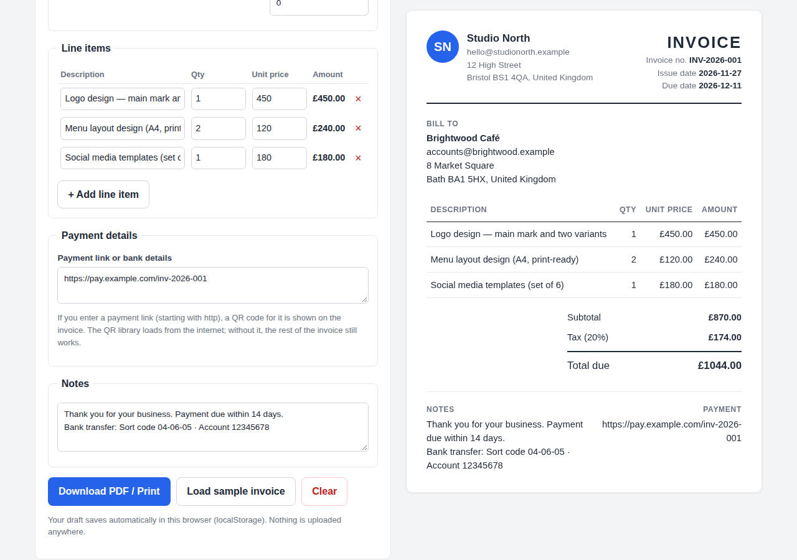
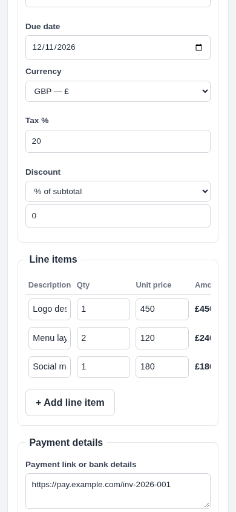

# Invoice Generator

A free invoice generator that runs entirely in your browser — a free alternative to paid invoicing tools like FreshBooks, QuickBooks and Invoicely, which paywall PDF export or demand a signup before you can send an invoice.

No signup. No backend. No account. Your data never leaves your device.

## Who it is for

Freelancers, small businesses and anyone who needs to send a clean, professional invoice without paying for invoicing software or handing their client data to a third party.

## How to run it

- **Online:** https://virabuilds.github.io/invoice-generator/ (once live on GitHub Pages)
- **Offline / locally:** download this repo and open `index.html` in any modern browser. No build step, no install.

## Features

- Business details (name, email, address) and client details (name, email, address)
- Auto-generated invoice number (editable), issue date and due date
- Line items table — add and remove rows, with quantity, unit price and live per-line amounts
- Live subtotal, tax % and discount (% of subtotal or a fixed amount)
- Currency switcher: GBP £, USD $, EUR € — the symbol updates everywhere, including totals
- Payment details section with a QR code for your payment link, rendered on the invoice
- Business logo as a letter badge — your business initials in a coloured circle on the invoice
- **Download PDF / Print** — uses your browser's print dialog with a clean, invoice-only layout
- **Load sample invoice** — fills in a fictional freelance design invoice so you can try it instantly
- Drafts save automatically in your browser (localStorage) and a **Clear** button resets everything
- Notes field printed on the invoice

## How totals are calculated

1. **Subtotal** = sum of (quantity × unit price) for every line item.
2. **Discount** is applied to the subtotal first — either a percentage of the subtotal or a fixed amount.
3. **Tax** is then charged on the discounted amount (subtotal − discount).
4. **Total due** = (subtotal − discount) + tax.

## Honest limits

- **Print-to-PDF uses your browser's print dialog**, so output quality depends on your browser. Use "Save as PDF" as the print destination.
- **The QR code needs internet** for the qrcode-generator library loaded from jsDelivr (`https://cdn.jsdelivr.net/npm/qrcode-generator@1.4.4/qrcode.min.js`). If that library can't load, the QR code is skipped and everything else still works.
- **Data is stored only in your browser's localStorage** and is never sent anywhere. Clearing your browser data deletes your draft.
- **No backend, no accounts, no invoice tracking or payment reminders.** This tool creates one invoice at a time; it does not store a list of invoices, track who has paid, or send reminders.

## Screenshots

## Donate

If this tool saved you time or money, you can support its development:

- **TON:** `UQAdlJHWw-2wkhmYEQDVb-bfsNdwKEFfF5T4MtuBSw5GJrdD`
- **EVM (Ethereum/BSC/Polygon):** `0xf38cAF0757B611fD625cA2c392b24D79025D62c9`

Coin/network unconfirmed for both addresses — please confirm before sending.

## License

MIT — see [LICENSE](LICENSE).
